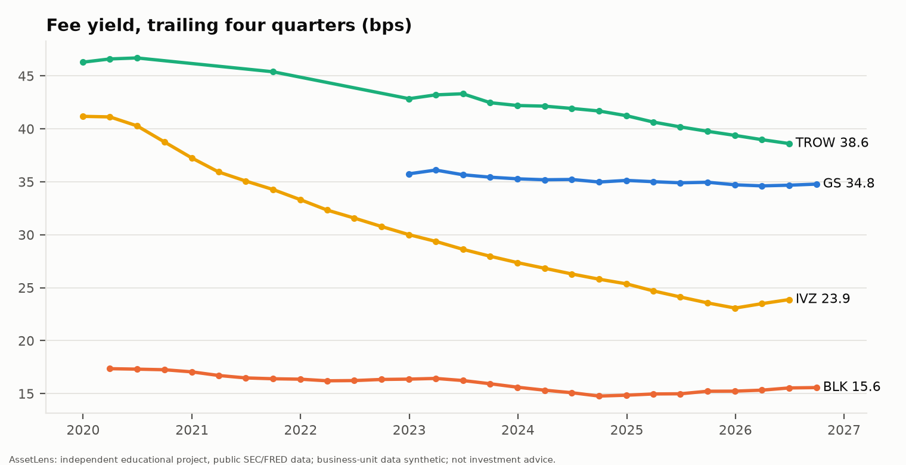
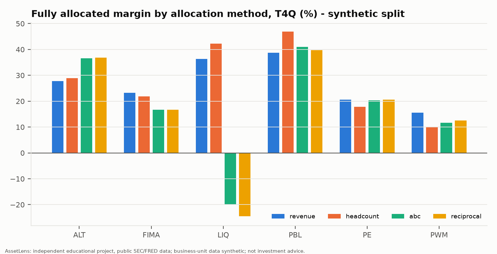

# AssetLens - asset manager benchmarking, profitability and FP&A platform

> AssetLens is an independent educational project built from publicly available SEC filings and FRED data. It is not affiliated with, endorsed by, or based on any non-public information from Goldman Sachs or any other company named. Business-unit, headcount, advisor, expense and compensation data are **synthetic**, generated to be consistent with public segment totals, and do not represent any company's internal figures. Nothing here is investment advice.

## What it found (public data unless marked synthetic)

1. **GS AWM is growing assets faster than peers, helped by liquidity products.** Assets under supervision reached $4.10tn at 30 Sep 2026; trailing-four-quarter organic growth is 14.9% vs BlackRock 6.5%, Invesco 7.6% and T. Rowe -3.2% (latest available quarters). Much of GS's inflow is low-fee liquidity products.
2. **Fee yields are falling at every peer.** T4Q yield: GS 34.8 bps, T. Rowe 38.6, Invesco 23.9, BlackRock 15.6. Fitted trends (HAC 95% CI, all significant): GS -0.33, BlackRock -0.35, T. Rowe -1.23, Invesco -2.89 bps a year. Definitions differ by company; see `comparability_flags`.
3. **Scenario range for the next eight quarters** (driver model, assumptions not forecasts): final-quarter pre-tax margin 29.3% base, 31.2% bull, 25.5% bear, 15.7% under a -25% equity stress.
4. **Allocation method changes the answer (synthetic businesses).** Liquidity Solutions shows +36% fully allocated margin on a revenue basis and about -20% under activity-based costing (rank 2 to 6) while its contribution margin stays positive. Marginal pricing floor on a $1bn equity mandate: 15.9 bps marginal vs 25.5 bps fully allocated break-even.
5. **GCC private wealth office (illustrative):** NPV $184m, but 93% is terminal value (explicit seven-year NPV $14m). Monte Carlo: mean NPV about $275m with a ~9% chance of loss; staging a pilot first lowers expected value by roughly $55-165m across gate/delay settings, so it works as risk control, not value creation. Back-test: the driver model's fee forecasts have 2.5-3.5% MAPE vs 4.5% for the best naive baseline (small sample).




## Deliverables
| Artifact | Location |
|---|---|
| Excel model (live formulas, 13 checks, Python parity) | `outputs/excel/AssetLens_PnL_Model.xlsx` |
| Board pack (5 slides + appendix) | `outputs/deck/AssetLens_Board_Pack.pptx` |
| Power BI assets (star schema, Power Query, DAX, RLS guide) | `outputs/powerbi/`, `powerbi/` |
| Streamlit app (8 pages), FastAPI | `app/streamlit_app.py` (`make app`), `src/assetlens/api/app.py` (`make api`) |
| AI layer (text-to-SQL, RAG, guardrail, extraction) | `src/assetlens/ai/`, results in `docs/modules/M17.md` |
| Warehouse (DuckDB) | `data/warehouse/assetlens.duckdb` (rebuilt by `make`) |
| Governance | `docs/` (MODEL_DOCUMENTATION, DECISIONS, DATA_GAPS, METRICS, ASSUMPTIONS_REGISTER.csv, DATA_DICTIONARY, RECONCILIATION_REPORT) |
| Progress and open items | `progress.md` |

## Run it
```
cp .env.example .env        # set SEC_USER_AGENT="Your Name your@email"
make setup
make all                    # ingest -> extract -> warehouse -> benchmark -> synth -> allocate -> forecast -> excel -> powerbi -> deck
make test                   # fast tests;  make test-all adds the Excel parity test (~80 s)
```
SEC requests are throttled to 8/s and cached under `data/raw/`; reruns make no network calls for cached items.

## Docker
```
make all                    # build the warehouse on the host first (data/ is mounted, not baked in)
docker compose up --build   # API on :8000 (/docs), Streamlit on :8501
```
The image installs only the core dependencies (AI, MLflow and report-building packages are extras: `uv sync --all-extras` for development). Verified by building and querying both services.

## Data quality summary
Every public fact has provenance (accession number, table locator, raw text, method). GS segment checks pass 19/19; peer AUM roll-forwards are accepted only if they close and chain. Known gaps (GS pre-2022 AWM quarters, Q3-2026 opex, two T. Rowe quarters, BLK market split) are listed in `docs/DATA_GAPS.md`.

## Status
All 18 modules are built. Not done or not verified: Claude evaluation (SQL agent on Ollama gemma4:31b scores 81.2% strict / 94.2% lenient execution accuracy, 9/12 on hard questions; details in `docs/modules/M17.md`), the Power BI `.pbix` and DAX execution, a PDF of the deck, and some older-filing parsers for MS/JPM/BEN (see `docs/DATA_GAPS.md`). See `progress.md`.
